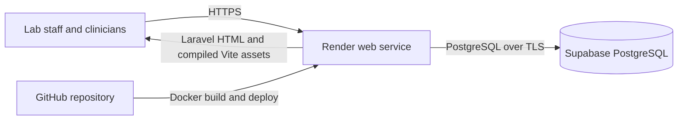

# Diagnostic-Laboratory

Diagnostic-Laboratory is a Laravel application for organizing common workflows in a diagnostic lab, including patient records, appointments, billing, sample processing, results, quality control, inventory, and staff access.

## Architecture



The Laravel application serves the web interface and connects to PostgreSQL. Vite compiles the frontend assets during the Docker build.

## Technology

- Laravel 13 and PHP 8.3 or later
- Blade, Tailwind CSS 4, and Vite
- SQLite, MySQL/MariaDB, or PostgreSQL
- Docker for the Render deployment

## Run locally

Requirements: PHP 8.3+, Composer 2+, Node.js, npm, and a supported database.

```powershell
composer install
npm ci
npm run build
Copy-Item .env.example .env
php artisan key:generate
```

Configure the database in `.env`, then set three different demo passwords of at least 16 characters:

```dotenv
DEMO_ADMIN_PASSWORD=
DEMO_TECHNICIAN_PASSWORD=
DEMO_FRONT_DESK_PASSWORD=
```

Create the schema and sample records, then start the local server:

```sh
php artisan migrate --seed
php artisan serve
```

The seeder creates a pathologist, technician, and front-desk account. Use the passwords configured in `.env`; there are no shared default passwords.

## Deploy with Render and Supabase

The repository includes a [`Dockerfile`](./Dockerfile) and [`render.yaml`](./render.yaml) Blueprint.

1. Create a Supabase project and copy its **Session pooler** PostgreSQL URI.
2. Connect the GitHub repository to Render using the Blueprint.
3. Set `DB_URL` to the Supabase URI with SSL required, and set `APP_URL` to the Render HTTPS address.
4. Deploy. The container runs Laravel migrations before starting the web server.
5. To add sample records, set unique `DEMO_*_PASSWORD` values in a private environment and run `php artisan db:seed --force` once.
6. With Render Auto-Deploy enabled, pushes to the linked branch trigger a new deploy.

Keep `.env` and database credentials out of Git. Render's local filesystem is temporary, so uploaded files may not persist between deployments. This setup is for demos with synthetic data only, not real patient information.
